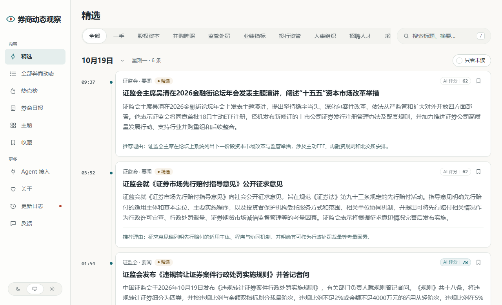

<p align="center">
  <picture>
    <source media="(prefers-color-scheme: dark)" srcset="site/brand/wordmark-dark.svg">
    
  </picture>
</p>

<p align="center">
  <a href="LICENSE"></a>
  
  
  
</p>

<p align="center">
  <b>国内证券公司的动态热点站。</b><br>
  自动盯住监管机构、交易所、上市券商公告和财经媒体，挑出值得看的，把同一件事的多篇报道归到一起，每天出一份日报。
</p>

<p align="center">
  <a href="#看一眼">看一眼</a> ·
  <a href="#盯哪些信源">盯哪些信源</a> ·
  <a href="#什么算重要什么是噪声">什么算重要</a> ·
  <a href="#跑起来">跑起来</a> ·
  <a href="#上线前要定的事">上线前要定的事</a> ·
  <a href="#文档">文档</a>
</p>

<br>

## 这是什么

券业观察每天从一批公开信源里收资料，先用大模型判断是不是券商行业的事，再独立打两次分，只留下真正值得看的，写成中文标题、摘要和推荐理由；不同来源报道的同一件事会归成一个事件，按有多少独立来源在说排出热点；每天 08:00 出一份日报，每周一出周报、每月 1 日出月报。

它关心的是券商自己的事，不是行情：

- **股权与资本**：股权结构和实际控制人变更、股东增减持、定增配股、次级债、对子公司增资
- **并购与牌照**：吸收合并的各个节点、同质化牌照清理、做市、碳交易、跨境等新业务资格
- **监管与处罚**：罚单、监管措施、纪律处分，以及影响券商业务边界的新规
- **业绩与指标**：业绩快报、营收利润结构、行业排名、净资本与风险覆盖率
- **投行、资管、人事、招聘、采购招标、跨境业务、金融科技与 AI**

荐股点评、营销软文、开户与理财广告、盘口和资金流碎片、无新信息的转载，都会被压住。

站点本身匿名、免注册；同一份内容通过网页、RSS、公开 API、MCP 和 `llms.txt` 提供。

## 看一眼

<picture>
  <source media="(prefers-color-scheme: dark)" srcset="docs/assets/screenshot-dark.png">
  
</picture>

<p align="center"><sub>截图来自本地跑起来的站，内容是当天从信源抓到的真实条目。</sub></p>

## 盯哪些信源

首次启动时导入 [`industry/sources.json`](industry/sources.json)。已启用的 16 个信源都用后台的“预览抓取”验证过：标题是文章标题，发布时间可读。

| 信源 | 内容 | 分级 | 间隔 |
|---|---|---|---|
| 证监会 | 要闻、辖区监管动态（各地证监局的警示函等）、监管措施、政策解读 | T1 官方 | 30–120 分钟 |
| 上交所、深交所 | 要闻动态 | T1 官方 | 60 分钟 |
| 中证协 | 协会工作动态、自律规则 | T1 官方 | 120 分钟 |
| 中基协 | 协会要闻、通知公告 | T1 官方 | 120 分钟 |
| 中国结算 | 通知公告（含券商终止登记服务等） | T1 官方 | 60 分钟 |
| 巨潮资讯 | 43 家上市券商的公告，已按标题过滤债券募集说明书、评级报告、付息兑付等例行文件 | T1 官方 | 60 分钟 |
| 证券时报 | 快讯（全市场，噪声较多，靠预筛过滤） | T2 媒体 | 30 分钟 |
| 第一财经 | 金融频道 | T2 媒体 | 30 分钟 |
| 财新 | 金融频道（发布时间从详情页读取） | T2 媒体 | 60 分钟 |
| 中国证券报 | 券商频道（首页的券商链接，详情页读取时间） | T2 媒体 | 60 分钟 |

**券商公众号**：[`industry/sources.json`](industry/sources.json) 里写了 22 个券商公众号（中信证券、招商证券、华泰证券资管、平安证券、申万宏源、国投证券、长江证券、光大证券、广发证券、东方财富证券、国泰海通等），默认**停用**。要启用，先在 `.env` 配 `DAJIALA_KEY`（[极致了](https://www.dajiala.com)，按请求计费），再在后台“信源”页打开。极致了要求 `ghid` 填 `gh_` 开头的原始 ID 或 6–20 位的微信号，只写了名称的账号查不了：其中 8 个已经填了微信号（`wxid`），其余 14 个要补上才能启用。极致了的默认预算是每分钟 5 次请求，首轮导入会被限流，调度器每 15 分钟一轮，几轮后补齐。

**暂时没有**（抓不到或没有可用接口，不是漏了）：北交所（官网只有 JS 跳转）、上海证券报、券商中国、财联社、每日经济新闻、各券商官网的新闻列表（需要真实的栏目地址）、X 与微博上的高管和分析师账号（X 需要 `SOCIALDATA_API_KEY`，微博框架不支持）。金融监管总局的栏目也验证过能抓，但偏银行保险，没有启用。信源的配置方法见 [信源](docs/sources.md)。

## 什么算重要，什么是噪声

分类共 12 个（`key` 会出现在网址和接口里，上线后不要改）：

| 类别 | `key` | 收什么 |
|---|---|---|
| 股权资本 | `capital` | 股权结构与实控人变更、股东增减持、定增配股、次级债、对子公司增资 |
| 并购牌照 | `mna` | 吸收合并及各阶段节点、牌照清理与整合、新业务资格获批 |
| 监管处罚 | `regulation` | 罚单、监管措施、纪律处分，影响业务边界的新规与征求意见稿 |
| 业绩指标 | `performance` | 业绩快报、营收利润结构、排名，净资本、风险覆盖率、融资利率 |
| 投行资管 | `deals` | ABS、REITs、IPO 保荐、再融资与并购财务顾问、重要资管产品 |
| 人事组织 | `people` | 董事长、总裁与高管任免，风控合规条线，分支机构撤并与条线重组 |
| 招聘人才 | `recruit` | 核心团队成建制引进或流出、保代与分析师流动、有规模的招聘 |
| 采购招标 | `procurement` | 信息系统、数据服务、研究服务等大额采购与中标 |
| 跨境业务 | `crossborder` | 香港与海外子公司增资、境外网点、跨境理财通、QFLP、互联互通 |
| 金融科技 | `fintech` | 自研大模型备案、智能投研与风控落地、监管对 AI 的合规意见 |
| 行业 | `industry` | 其他与券商行业有关的已发生事件 |
| 评论解读 | `opinion` | 对行业事件的分析、解读和访谈 |

**要压住的噪声**：无逻辑的行情复盘和荐股、营销软文与获奖喜报、开户和理财广告、没有新信息的转载与洗稿、没有盈利预测支撑的目标价、盘口与资金流碎片、CPI/PMI 之类的例行快评、股吧和大 V 的情绪、没有实质议程的路演通知、被包装成“大动作”的招聘与采购标题党。监管机构内部的党务和干部处分，只要不涉及券商及其从业人员，也不算。

这些标准写在 [`industry/prompts/`](industry/prompts/)（评分标准是 `selection-score.md`，预筛是 `prefilter.md`），改标准不用改代码。

### 券商主题

主题目录使用“券商公司”“业务与主题”“内容类型”三个 Tab 切换，默认显示券商公司；切换不影响各主题原有地址。

“主题”页（`/topics`）里，**每家国内证券公司一个主题页**，共 109 家：中信、华泰、国泰海通、中金等头部券商，以及中证协名单（2025-12-31 更新）里的其余券商，包括区域性券商和中外合资、外资控股券商（高盛、摩根大通、瑞银、星展等）。券商的资管、承销保荐子公司并进母公司的主题，不另开页面。另有 13 个业务主题（并购与牌照、监管与处罚、业绩与排名……）和 3 个内容类型主题。

- 一篇报道的主体是哪几家券商，由模型在结构化一步里判断；主题页收“以这家券商为主体”的报道，只是顺带提到的不算。
- 券商名录在 [`industry/brokers.ts`](industry/brokers.ts)（头部券商在 `industry/taxonomy.ts`）。**新增或更名一家券商**：在 `brokers.ts` 加一行，再在 [`industry/topics.json`](industry/topics.json) 加一行同 id 的公司主题，然后重新构建；`tests/industry-pack.test.ts` 会检查两边是否一致、名字有没有歧义。
- 名录更新前就已入库的文章没有这些公司的标签，要出现在对应的主题页里，需要在后台重新处理一次。

## 它是怎么工作的

<picture>
  <source media="(prefers-color-scheme: dark)" srcset="docs/assets/how-dark.png">
  
</picture>

一条资料从信源进来，先判重、再预筛；可能重要的由同一份评分标准独立打两次分，再按信源分级的门槛决定入选，同时写好中文标题和摘要。分数过了门槛、又不是精选里已有新闻的重复，才进精选。

**聚簇**：同一件事，监管官网发一篇、券商公告一条、媒体转十篇，读者只需要看到一次。系统把它们归成一个**事件**，同一事件的后续进展（筹划、受理、获批、完成）挂在同一个事件下；**热度**按事件算，48 小时内每个独立来源只算一次。

**成刊**：日报按规则编出当天要闻，不调用模型；周报、月报从日报汇编，模型只写总述和栏目导读。出刊时间在 [`site/site.ts`](site/site.ts) 的 `EDITION_TIMES` 里改。

详见 [精选与校准](docs/selection.md) 和 [事件归组](docs/grouping.md)。

## 跑起来

需要 [Docker](https://docs.docker.com/get-started/get-docker/)（Windows 用 Docker Desktop）、[Node.js 24](https://nodejs.org/en/download)（只用来生成 `.env`）和一个 OpenAI 兼容的模型 API Key（DeepSeek、千问、智谱都可以）。

```bash
git clone https://github.com/WutongTree-bit/follow.git
cd follow
node scripts/init-env.ts --llm-key <你的模型 API Key>
docker compose up -d --build
```

打开 <http://localhost:3000>，后台在 `/admin`，管理员密码在 `.env` 的 `ADMIN_PASSWORD` 里。一两分钟后开始有内容，第一次导入的资料大约半小时处理完（每个信源首次最多取最近 8 条）。

- 改了 `site/` 或 `industry/`（包括 `topics.json`）后，重新执行 `docker compose up -d --build` 才生效。
- `industry/sources.json` 只在首次启动时导入，之后每次启动只补上库里还没有的；要停用或调整信源，在后台“信源”页操作。
- `docker compose down` 只停服务，`docker compose down -v` 会连数据库和上传文件一起删掉。
- 默认模型是 DeepSeek。用千问、智谱等别家，照 `.env.example` 里的例子改 `LLM_BASE_URL`、`LLM_MODEL` 和 `LLM_EXTRA_JSON`；用推理模型时再设 `LLM_REASONING_TOKENS`。
- 服务器在中国大陆、配域名和 HTTPS、不用 Docker 直接跑，见 [部署](docs/deploy.md)。

### 配置

`.env` 里最常用的几项（完整列表和说明在 [`.env.example`](.env.example)）：

| 变量 | 作用 |
|---|---|
| `LLM_BASE_URL`、`LLM_API_KEY`、`LLM_MODEL` | 所有步骤默认使用的模型 |
| `SITE_URL` | 站点的公开地址，生成 RSS、分享图和站点地图用 |
| `COLLECT_ENABLED`、`MODEL_CALLS_ENABLED` | 后台自动采集和模型调用的总开关，设成 `false` 就停掉（后台“预览抓取”仍会发出请求） |
| `FEISHU_CONTENT_PUSH_ENABLED`、`FEISHU_INTERNAL_ENABLED`、`INDEXNOW_SUBMIT_ENABLED` | 飞书推送、内部告警和搜索引擎提交，默认关闭 |
| `DAJIALA_KEY` | 启用券商公众号信源 |
| `JINA_API_KEY` | 网页正文读取兜底（按次计费）；没配时，个别页面读不到正文，重试几次后只按标题和摘要判断 |
| `SOCIALDATA_API_KEY` | 启用 X 账号信源 |

付费服务（模型、极致了、Jina）都经过回执和预算熔断，上限在后台“设置”里调。

### 对外接口

| 入口 | 内容 |
|---|---|
| `/feed.xml`、`/feed/all.xml` | 精选、全部动态的 RSS；还有分类、日报、周报、月报的订阅 |
| `/api/v1/items`、`/api/v1/hot-topics`、`/api/v1/selected/snapshot` | 公开 API，说明在 `/openapi-v1.json` |
| `/api/mcp` | MCP，工具名前缀是 `brokerwatch_`（如 `brokerwatch_get_latest`） |
| `/api/v1/agent`、`/llms.txt` | 给只能读网页的 Agent 和大模型的 Markdown 与站点说明 |
| `/agent` | 接入方式的说明页，可以直接复制配置 |

## 上线前要定的事

现在这套能跑，但下面几件事需要运营者自己决定：

- [ ] **入选门槛**：仍是默认值（T1 60、T1_5 65、T2 76），是在 AI 行业校准的。挑 100–200 条自己标注“该选 / 不该选”的资料存成 `.data/gold.jsonl`，用 `node --env-file=.env scripts/eval-selection.ts --gold .data/gold.jsonl` 重新校准，见 [精选与校准](docs/selection.md)。
- [ ] **使用规则与隐私说明**：[`site/pages/`](site/pages/) 里还是模板，要按实际的运营主体、联系方式和允许的用途改写，必要时请专业人士审阅。
- [ ] **券商公众号**：配好 `DAJIALA_KEY` 后，给只有名称的 14 个账号补上微信号或 `ghid`，再启用。
- [ ] **备案与联系方式**：`site/site.ts` 里的 `icp`、`psb`、`contactEmail` 还是空的。
- [ ] **缺的信源**：券商官网的新闻列表需要真实栏目地址；X 账号需要 `SOCIALDATA_API_KEY` 和具体账号。
- [ ] **热点榜**：来源还不多时，热点榜常常是空的。可以在 `site/site.ts` 的 `NAV.hidden` 里加入 `"/hot"` 暂时隐藏。
- [ ] **域名**：`SITE_URL` 和 `TRUST_PROXY` 按实际部署设置。

## 开发与检查

```bash
npm run typecheck
DATABASE_URL=postgres://<账号>:<密码>@127.0.0.1:5432/brokerwatch_test npm test   # 库名必须以 _test 或 _ci 结尾，账号要能建库
npm run build -w @aihot/web && node --test apps/web/tests/*.test.ts
node scripts/smoke.ts --base http://localhost:3000                              # 站点跑起来以后
```

- 在 Windows 上，涉及 `pg_dump`、`tar`、`openssl` 和 SIGTERM 的测试（备份、`*-shutdown`、`error-logging`、`outbound-*`、`mcp-host`）跑不通；它们在 Linux 或 Docker 里可以通过。`apps/web` 里个别浏览器测试在 Windows 上偶尔失败。
- 改了分类、标签或公司（`industry/taxonomy.ts`）后，`tests/` 里用到旧例子的夹具要跟着换。
- 贡献代码前先读 [AGENTS.md](AGENTS.md)：前端只通过 HTTP 读 `apps/api`，模型只在 worker 的任务里调用，所有公开出口都从 `packages/backend/src/publication/` 读取。

### 目录

| 目录 | 内容 |
|---|---|
| [`site/`](site/) | 这个站自己的东西：站名与文案（`site.ts`）、模型（`models.ts`）、Logo 与品牌（`brand/`）、条款页、更新日志 |
| [`industry/`](industry/) | 券商行业的知识：分类与标签（`taxonomy.ts`）、券商名录（`brokers.ts`）、主题（`topics.json`）、信源、提示词、门槛（`selection.ts`） |
| `apps/` | `api`（Fastify）、`web`（React Router 服务端渲染）、`worker`（采集与各类任务） |
| `packages/` | `backend`（业务逻辑）、`contracts`（前后端共用的类型与规则） |
| `modules/` | 只有这个站要的功能，默认为空 |
| `database/`、`scripts/`、`tests/`、`docs/` | 迁移、脚本、测试、文档 |

技术栈：Node.js 24 · TypeScript · React Router · Fastify · PostgreSQL · pg-boss · Tailwind CSS · Docker Compose。

## 文档

| 文档 | 内容 |
|---|---|
| [把它改成你的行业](docs/customize.md) | 站名、分类、主题、信源、提示词、门槛、模型、品牌的改法 |
| [信源](docs/sources.md) | 信源类型与配置、分级与全文、抓取频率、旧文不刷屏 |
| [精选与校准](docs/selection.md) | 一条资料怎么变成精选、怎么编进日报，怎么用自己的样本校准门槛 |
| [事件归组与关系评测](docs/grouping.md) | 事件关系怎么判断，怎么评测 |
| [综述评测](docs/story-digest-evaluation.md) | 改事件综述提示词前怎么并排比较 |
| [部署](docs/deploy.md) | Docker、域名与 HTTPS、中国大陆、更新、备份、费用 |
| [架构](docs/architecture.md) | 三个进程、不变的规则、目录、模块、数据库迁移 |

## 致谢与许可

本站基于开源框架 [AIHOT](https://github.com/KKKKhazix/AIHOT)（作者数字生命卡兹克，MIT 许可）搭建：采集、精选、聚簇、热度、日报和后台都来自这个框架，本仓库只替换了券商行业的内容和品牌。代码里的 `@aihot/*` 包名和 `AIHOT_*` 环境变量是框架原有的命名，没有改。AIHOT 的名字和 Logo 不在许可范围内，本站没有使用。

想同步框架的后续更新，可以把它加成另一个远程：

```bash
git remote add upstream https://github.com/KKKKhazix/AIHOT.git
git fetch upstream && git merge upstream/main
```

代码使用 [MIT 许可证](LICENSE)，原作者的版权声明需要保留。字体有自己的许可，见 [NOTICE](NOTICE)。
